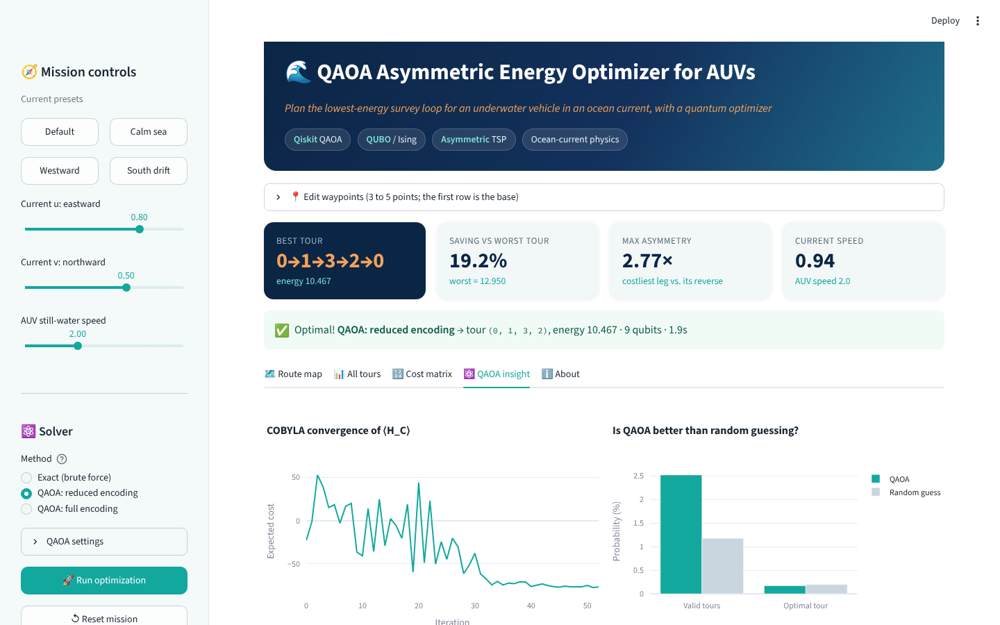

# QAOA Asymmetric Energy Optimization for Marine AUVs


## What it does

An Autonomous Underwater Vehicle (AUV) must visit several survey points and return to base on one battery charge. Ocean currents make each leg cost a different amount depending on direction, so the problem is an **Asymmetric Traveling Salesperson Problem (ATSP)**. This project:

1. turns the current field into an asymmetric energy-cost matrix,
2. compiles the ATSP into a QUBO / Ising Hamiltonian (DOcplex + Qiskit Optimization),
3. solves it with **QAOA** (p = 3, COBYLA) and checks the answer against an exact eigensolver and brute force,
4. draws an interactive Plotly map with the current field, waypoints and optimal tour,
5. wraps everything in an **interactive web dashboard** (Streamlit).

## Interactive dashboard

```bash
pip install -r requirements.txt
streamlit run app.py
```

- **Current presets** (Default / Calm sea / Westward / South drift) plus sliders for current and AUV speed
- **Editable waypoints table**: add, move or remove survey points (3 to 5)
- **Solver picker**: exact brute force, 9-qubit reduced QAOA or 16-qubit full QAOA, with layers, iterations, shots and seed
- **🚀 Run optimization** and **↺ Reset mission** buttons
- **▶ Play AUV** animation: the vehicle visibly slows down on legs against the current
- **Compare** the optimal tour with any other tour on the map
- Tabs: Route map · All tours chart · Cost-matrix heatmap · QAOA insight (convergence, QAOA vs random guessing) · About



## Project structure

```
auv-qaoa/
├── app.py                   # interactive Streamlit dashboard
├── main.py                  # run the whole pipeline from the command line
├── config/mission.json      # waypoints, current, AUV speed (edit to try new missions)
├── auv_qaoa/
│   ├── physics.py           # effective speed + asymmetric cost matrix
│   ├── qubo.py              # full (N²) and reduced ((N-1)²) QUBO encodings, decoding
│   ├── solvers.py           # brute force, exact eigensolver, QAOA
│   └── visualize.py         # interactive Plotly route map + convergence plot
├── tests/test_pipeline.py   # 6 unit tests
├── docs/                    # screenshots
└── outputs/                 # results.json, route_map.html, convergence.html
```

## Command-line run

```bash
pip install -r requirements.txt
python main.py                 # exact solver + 9-qubit QAOA, 5 seeds (~10 s)
python main.py --full          # also run the 16-qubit QAOA (~40 s per seed)
python main.py --exact-only    # quick check without QAOA
python -m pytest tests         # run the tests
```

Open `outputs/route_map.html` in a browser. Hover over a leg to see its cost and the cost of the reverse leg.

## Physics model

- Effective speed along a leg: `V_eff = V_b + V_c · d̂_ij`
- Leg cost (time, proportional to energy at constant power): `C_ij = distance_ij / V_eff`
- Reversing a leg flips the sign of the current term, so `C_ij ≠ C_ji`.

## Results (default mission)

| Tour | Energy | vs. optimum |
|---|---|---|
| **0-1-3-2-0** | **10.467** | best |
| 0-2-3-1-0 | 10.686 | +2.1% |
| 0-3-2-1-0 | 11.182 | +6.8% |
| 0-1-2-3-0 | 11.641 | +11.2% |
| 0-2-1-3-0 | 12.859 | +22.9% |
| 0-3-1-2-0 | 12.950 | +23.7% |

- The exact eigensolver finds the optimum in about 0.05 s.
- 9-qubit QAOA (base fixed at step 0) finds the optimum in 5/5 seeds.
- 16-qubit QAOA (full encoding) usually fails to find it: P(feasible) is about 0.1–0.3%. Exact outcomes vary with seed and shot count.
- With only 6 possible tours this is a proof of concept. It does **not** show quantum advantage.

## Trying your own mission

Edit `config/mission.json`: add waypoints, change the current or the AUV speed. The current speed must be below the AUV speed. The full encoding needs N² qubits, so keep N ≤ 5 on a laptop simulator. Use the reduced encoding for 5 waypoints (16 qubits).
