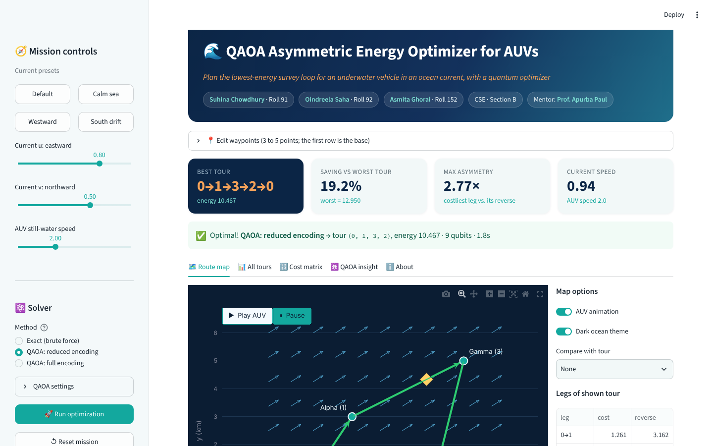

# 🌊 QAOA Asymmetric Energy Optimization for Marine AUVs

**Plan the lowest-energy survey route for an underwater robot in an ocean current, using a quantum optimization algorithm.**

🔗 **Live demo:** https://auv-quantum-energy-optimizer.streamlit.app/



---

## 📌 Overview

Autonomous Underwater Vehicles (AUVs) carry out high-stakes subsea missions: inspecting oil pipelines, mapping the seabed, tracking oil spills and surveying thermal vents. They run on batteries, so every mission has to visit all its targets and get back to base on one charge.

On land, driving from A to B costs about the same as driving from B to A. **Underwater, that is not true.** Ocean currents push the vehicle:

- 🟢 **With the current**, the AUV moves faster and saves battery.
- 🔴 **Against the current**, it slows down, fights drag and drains battery.

The order in which the AUV visits its targets therefore matters, and the cost of a route depends on its direction. Mathematically this is the **Asymmetric Traveling Salesperson Problem (ATSP)**, a classic NP-hard optimization problem.

This project builds a complete pipeline that:

1. turns ocean-current physics into a direction-dependent **energy-cost matrix**,
2. rewrites the routing problem as a **QUBO / Ising Hamiltonian** that a quantum computer can work on,
3. solves it with the **Quantum Approximate Optimization Algorithm (QAOA)** in Qiskit,
4. checks the answer against exact classical solvers,
5. presents everything in an **interactive web dashboard** with an animated AUV.

---

## ⚙️ How it works

```
Ocean current + waypoints
          │
          ▼
  ① Physics model ──► asymmetric cost matrix C[i][j]
          │
          ▼
  ② QUBO formulation ──► binary variables + penalty constraints
          │
          ▼
  ③ Ising Hamiltonian ──► qubit operator H_C
          │
          ▼
  ④ QAOA (p layers) + COBYLA optimizer ──► best bitstring
          │
          ▼
  ⑤ Decode ──► route  ──►  verified against brute force
```

### ① Physics: why costs are asymmetric

The AUV's speed along a leg from point *i* to point *j* is its still-water speed plus the part of the current pointing along that leg:

```
V_eff(i→j) = V_b + V_current · d̂(i→j)
C(i→j)     = distance(i, j) / V_eff(i→j)        (travel time ∝ energy at constant power)
```

Reversing a leg flips the sign of the current term, so **C(i→j) ≠ C(j→i)**. In the default mission one leg costs **2.75 times** more in one direction than the other.

### ② QUBO: turning routing into binary variables

Each choice "visit node *i* at step *t*" becomes a binary variable `x(i,t)`. The objective adds up the cost of every consecutive pair of visits:

```
minimize   Σ_t Σ_i Σ_j  C(i,j) · x(i,t) · x(j,t+1)
```

Two rules make a route valid: exactly one node per step, and each node visited exactly once. These rules are added to the objective as **quadratic penalty terms**, which gives an unconstrained problem (QUBO).

### ③ & ④ QAOA: the quantum optimizer

The QUBO is mapped to an Ising Hamiltonian `H_C`. QAOA prepares a quantum state by alternating "cost" and "mixer" layers:

```
|γ, β⟩ = Π_k  e^(−iβ_k H_M) · e^(−iγ_k H_C) · |+⟩^⊗n
```

A classical optimizer (COBYLA) tunes the angles γ and β to lower the expected cost. The lowest-cost bitstring measured is decoded back into a route.

Two encodings are implemented:

| Encoding | Qubits (4 waypoints) | Idea |
|---|---|---|
| **Full** | N² = 16 | Every node at every step, including the base |
| **Reduced** | (N−1)² = 9 | Base is fixed as the first stop, which removes redundant qubits |

---

## 🖥️ Interactive dashboard

| Feature | What you can do |
|---|---|
| 🌊 **Current presets** | One-click Default, Calm sea, Westward and South drift currents |
| 🎚️ **Sliders** | Change current direction and strength, and the AUV's speed |
| 📍 **Waypoint editor** | Add, move or delete survey points (3 to 5) |
| ⚛️ **Solver picker** | Exact brute force, 9-qubit QAOA or 16-qubit QAOA; adjust layers, iterations, shots and seed |
| 🚀 **Run / ↺ Reset** | Run the optimizer or go back to the default mission |
| ▶️ **Play AUV** | Watch the vehicle travel the route; it visibly slows down against the current |
| 🔀 **Compare tours** | Overlay any other route as a dashed line next to the optimal one |
| 📊 **Analysis tabs** | All-tours chart, cost-matrix heatmap, QAOA convergence, and QAOA compared with random guessing |


---

## 📈 Results (default mission)

Four waypoints: a base hub, an oil-spill edge, a fault line and a thermal-vent cluster, in a current of (0.8, 0.5).

| Route | Energy | vs. best |
|---|---|---|
| **0 → 1 → 3 → 2 → 0** | **10.467** | ✅ best |
| 0 → 2 → 3 → 1 → 0 | 10.686 | +2.1% |
| 0 → 3 → 2 → 1 → 0 | 11.182 | +6.8% |
| 0 → 1 → 2 → 3 → 0 | 11.641 | +11.2% |
| 0 → 2 → 1 → 3 → 0 | 12.859 | +22.9% |
| 0 → 3 → 1 → 2 → 0 | 12.950 | +23.7% |

**Findings**

- The best route saves **19.2%** energy compared with the worst one.
- The best route and its exact reverse cover the same distance, yet the reverse costs 2.1% more. A planner that ignores currents cannot tell them apart.
- **Reduced 9-qubit QAOA** found the optimal route in **5 out of 5** runs.
- **Full 16-qubit QAOA** mostly failed: only about 0.1–0.3% of its measurements were valid routes, because penalty-based encodings waste most of the quantum search space.
- **Lesson:** a smarter encoding mattered more than a deeper circuit.

---

## 🚀 Getting started

```bash
git clone https://github.com/oindreela04/auv-qaoa-energy-optimization
cd auv-qaoa-energy-optimization
pip install -r requirements.txt

streamlit run app.py              # interactive dashboard
python main.py                    # command line: exact solver + 9-qubit QAOA
python main.py --full             # also run the 16-qubit QAOA (slower)
python -m pytest tests            # run the unit tests
```

To try your own mission, edit `config/mission.json` (waypoints, current, AUV speed) or use the waypoint editor in the dashboard. The current must be slower than the AUV.

---

## 🗂️ Project structure

```
├── app.py                   # Streamlit dashboard
├── main.py                  # command-line pipeline
├── config/mission.json      # mission definition
├── auv_qaoa/
│   ├── physics.py           # effective speed + asymmetric cost matrix
│   ├── qubo.py              # full and reduced QUBO encodings, route decoding
│   ├── solvers.py           # brute force, exact eigensolver, QAOA
│   └── visualize.py         # Plotly route map with AUV animation
├── tests/test_pipeline.py   # unit tests
└── docs/                    # screenshots
```

## 🧰 Tech stack

Python · Qiskit · Qiskit Optimization · DOcplex · NumPy · Plotly · Streamlit · pytest

## ⚠️ Limitations and future work

- **Current model:** the current is uniform and steady. Next step: real, time-varying ocean-current data.
- **Problem size:** small instances only, since the encoding needs N² qubits. Next step: XY mixers that keep QAOA inside valid routes.
- **Hardware:** all runs use a noise-free simulator. Next step: noisy simulators and real quantum hardware.
- **More vehicles:** next step is multi-AUV routing with battery and time-window limits.
